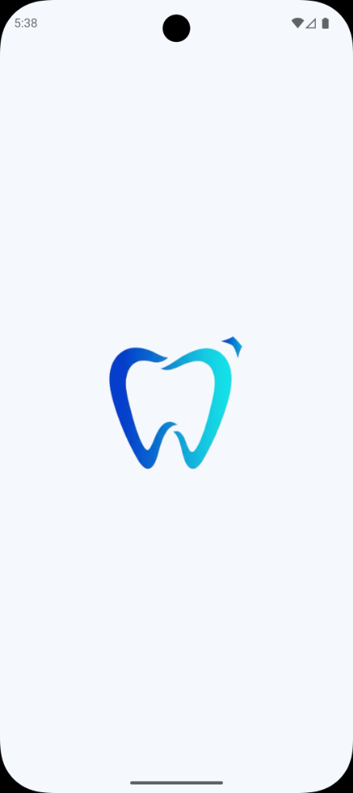
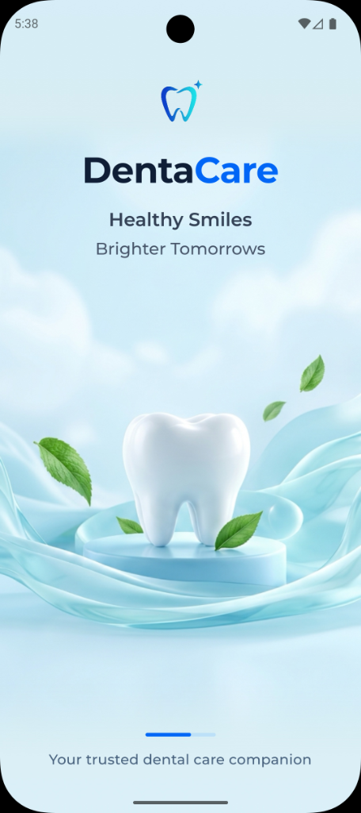
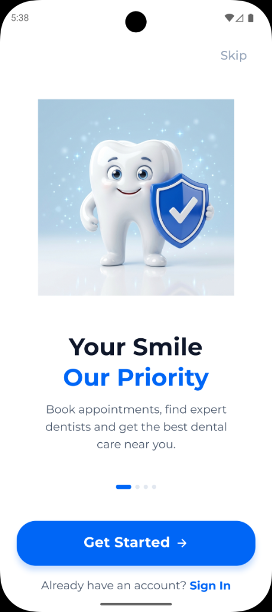
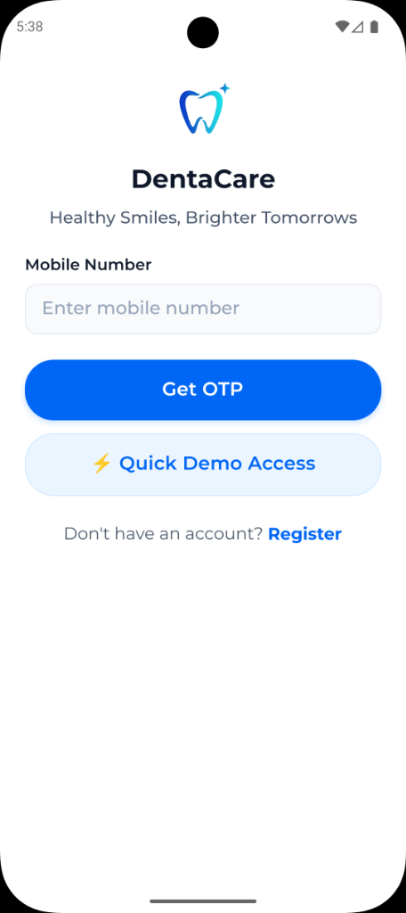
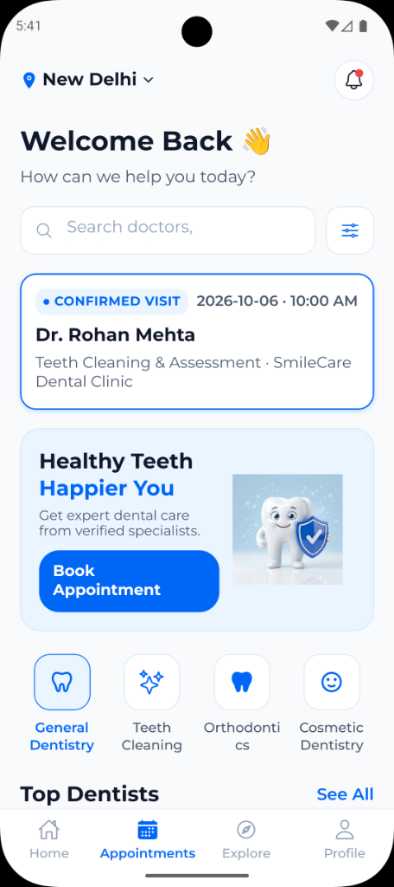
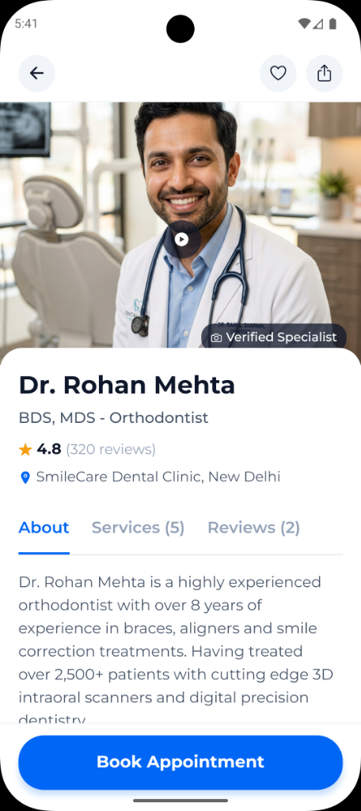
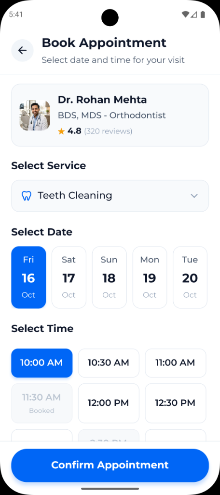
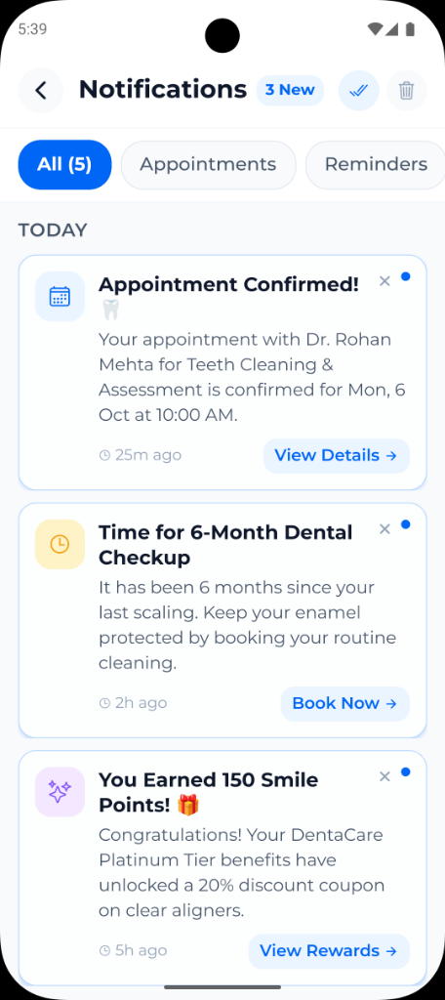
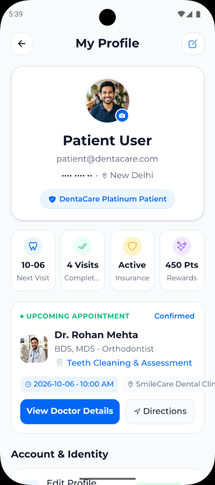
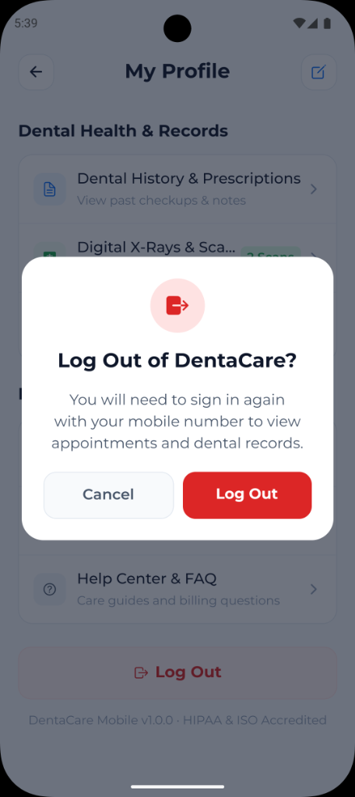

# 🦷 DentaCare - Dental Clinic App

A modern dental care and appointment booking mobile app built with **React Native** and **Expo**.

> 💡 **Personal Project**: An independent, self-developed personal portfolio project built from scratch for learning and demonstration. All doctor profiles, user details, and clinic records shown are mock/dummy data.

---

## 📱 App Screenshots

### Onboarding & Authentication Flow

|                             1. Splash                              |                              2. Welcome                              |                               3. Onboarding                                |                             4. Login                             |                               5. Dashboard                               |
| :----------------------------------------------------------------: | :------------------------------------------------------------------: | :------------------------------------------------------------------------: | :--------------------------------------------------------------: | :----------------------------------------------------------------------: |
|  |  |  |  |  |

### Booking, Notifications & Profile

|                                 6. Doctor Profile                                 |                                  7. Book Appointment                                   |                                 8. Notifications                                 |                            9. My Profile                             |                             10. Logout                             |
| :-------------------------------------------------------------------------------: | :------------------------------------------------------------------------------------: | :------------------------------------------------------------------------------: | :------------------------------------------------------------------: | :----------------------------------------------------------------: |
|  |  |  |  |  |

---

## ✨ Key Features

- **Mobile & OTP Login**: Quick phone-based authentication with demo access.
- **Find Dentists**: Browse dental specialists by category (Orthodontics, Cleaning, Cosmetic, etc.).
- **Book Appointments**: Choose dates and available time slots with instant confirmation.
- **Appointment History & Reminders**: Real-time notifications and checkup reminders.
- **Patient Profile**: View visits, health records, and loyalty points with masked credentials.
- **Toast Feedback**: Non-blocking toast notifications for errors, warnings, and success messages.

---

## 🛠️ Tech Stack

- **React Native** (v0.86) & **Expo** (SDK 57)
- **TypeScript**
- **React Navigation**
- **Redux Toolkit**
- **Axios**
- **React Native Toast Message**

---

## 🚀 Getting Started

1. **Clone the repository:**

   ```bash
   git clone https://github.com/rachna-khatnawlia/DentalDemo.git
   cd DentalDemo
   ```

2. **Install dependencies:**

   ```bash
   npm install
   ```

3. **Start the app:**
   ```bash
   npx expo start
   ```

---

## 📄 License

This project is open-source under the [MIT License](LICENSE).
